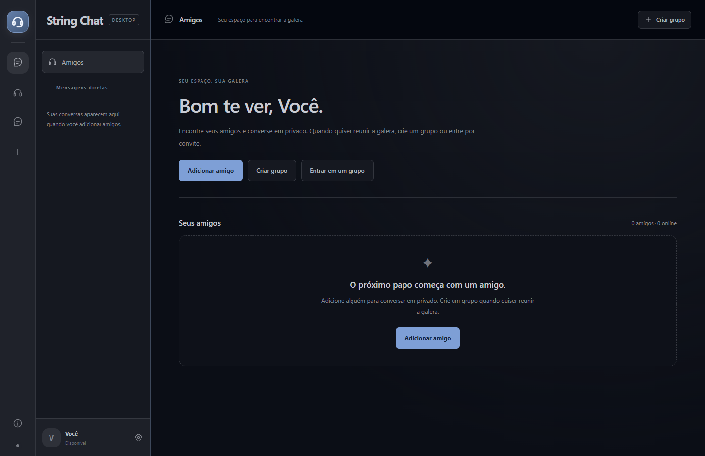

# String Chat

Aplicativo desktop para Windows: amigos, mensagens privadas, grupos com canais de voz e texto, webcam e compartilhamento de tela entre PCs na mesma LAN ou rede Radmin.



## Instalar

Na página **Releases** deste repositório, baixe `StringChat-Setup-1.5.0.exe` e execute em todos os PCs. O setup inclui o runtime; quem usa o programa não precisa instalar Node.js. Atualizações são feitas executando o novo setup, que preserva o perfil e remove versões instaladas anteriores reconhecidas após concluir a instalação.

`StringChat-Desktop.zip` é a alternativa portátil: extraia todos os arquivos juntos e abra `StringChat.exe`. Não há atualização automática pela internet nesta versão.

Veja o [guia de uso](docs/COMO-USAR.md) e as [notas da versão 1.5.0](docs/NOTAS-1.5.0.md).

## Recursos

- Amigos, pedidos de amizade e mensagens privadas sem entrar em grupo.
- Grupos com canais de texto e voz, convites reutilizáveis e até 6 participantes.
- Texto, imagens, GIFs, emojis e arquivos de até 8 MB; imagens podem ser ampliadas.
- Tela com meta de 1080p60; limite padrão de 25 Mbps por espectador, ajustável até 50 Mbps. A taxa real depende da rede, do conteúdo e do hardware.
- Webcam, volume por transmissão, controles sobre o vídeo e tela cheia.
- RNNoise local, cancelamento de eco do microfone e captura de som que exclui o próprio app para evitar retransmitir as vozes da chamada.
- Temas claro/escuro em azul e cinza, sons de interface, foto de perfil e bandeja.
- Atalhos globais configuráveis: `Ctrl+Shift+M` para microfone e `Ctrl+Shift+D` para áudio recebido e pausa/restauração do microfone. O X encerra por padrão; continuar na bandeja é opcional.

## Rede e dados

Não é necessário hospedar um serviço. Abra o Radmin antes do app e conecte todos à mesma rede virtual. O criador mantém o app aberto: seu PC coordena o grupo e armazena o histórico recente dele. A mídia usa WebRTC entre participantes; o upload necessário cresce com a quantidade de espectadores.

As mensagens privadas usam conexão e chave próprias de cada amizade. Os dois PCs precisam estar online e alcançáveis para entregar novas mensagens. Envios sem confirmação podem ser tentados novamente. O histórico é local e não recebe criptografia adicional em disco. Compartilhe convites e códigos de amizade somente com pessoas autorizadas.

Perfis ficam em `%APPDATA%\StringChat`. Nenhum perfil, chave ou conversa é incluído neste repositório.

A captura de som sem as vozes da chamada exige process loopback do Windows: Windows 11 ou build 20348+. O app informa quando o recurso não está disponível.

## Desenvolver

Requisitos: Windows x64, Node.js 22.12+ e compilador C# do .NET Framework 4.x do Windows. Electron fixado em 45.0.0.

```powershell
npm ci
npm run check
npm test
npm start
```

`npm start` compila o auxiliar de áudio e abre o Electron na própria janela. O serviço HTTP local é interno ao programa.

## Gerar instalador

```powershell
npm run build:windows
```

O comando compila os auxiliares C#, monta o runtime, aplica ícone/metadados e gera o manifesto SHA-256, o setup e o ZIP em `dist/`. Os executáveis não recebem assinatura de código comercial. Hashes verificam integridade, não identidade do editor.

O workflow manual **Windows package** gera os mesmos arquivos como artefatos, sem publicar releases automaticamente. Veja [desenvolvimento e versões](docs/DESENVOLVIMENTO.md).

| Arquivo/pasta | Responsabilidade |
| --- | --- |
| `desktop-main.mjs`, `desktop-preload.cjs` | Janela, bandeja, permissões e integração desktop |
| `rtc.js`, `media-policy.js` | WebRTC, bitrate, codecs e sincronização |
| `microphone.js`, `system-audio*.js` | Microfone, RNNoise e captura de som |
| `room-service.mjs`, `friends-service.mjs`, `direct-messages.mjs` | Grupos, amizades e mensagens privadas |
| `native/` | Fontes C# da captura WASAPI, setup e launcher/desinstalador |
| `vendor/` | RNNoise e licenças dos componentes terceiros |
| `scripts/`, `tests/` | Compilação, empacotamento e verificações |

Os avisos dos componentes terceiros permanecem em `vendor/` e no runtime distribuído. Nenhuma licença aberta para o código próprio foi escolhida neste repositório.
